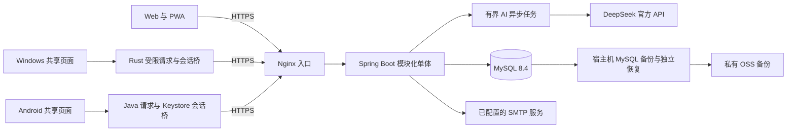
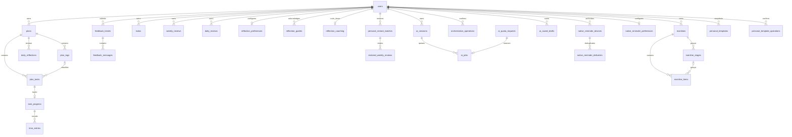

# 计划舱架构与一致性设计

计划舱采用模块化单体：Vue 3共享业务页面运行在Web/PWA、Tauri Windows和Capacitor Android中，通过同一Spring Boot API使用MySQL。正式三端均为0.1.19／Android24，含私人整套模板及试用收口，见[发布记录](release-0119.md)。本页为2026年10月22日源码与交付记录核对结果，不是一次新的生产探测。微信小程序、iOS、微服务与本地大模型没有实现。

## 运行结构

三端只是不同交付壳，不是三套业务后端。Windows/Android 原生层限制请求目标、保护刷新会话、处理签名更新；JS 业务数据与离线队列按账号和服务器隔离。Service Worker 缓存页面壳，不缓存私有 API；业务快照通过受控 IndexedDB 单独保存。

生产是 2 核、约 2GB 内存 ECS 上的 Nginx、一个 Spring Boot 进程和 MySQL，并保留旧 Node 服务用于回退材料。没有部署 Redis、Kafka、Prometheus 或 Grafana。OSS 保存私有备份，不作为任意用户附件或公开导出存储。

## 为什么不拆微服务

任务进度、计时流水、路线依赖、批量调整和应用记录存在紧密事务边界。单体可以在一个数据库事务内校验所有权、锁住必要记录并提交；当前小范围受邀试用也不值得承担分布式事务与额外进程的成本。只有测得真实瓶颈后再讨论分离任务处理或统计，不把框架数量当作项目规模。

## 所有权与数据库关系

公开 ID 使用 UUID，但 UUID 不是权限控制。普通业务查询必须通过本人 `owner_id` 或所属计划／路线验证所有权；管理员角色不自动获得读取他人私人业务的能力。

图只显示主要关系，不是完整建表DDL。路线前置ID存于 `prerequisite_ids_json`，不是图中另造的关系表；服务层根据完整路线检查同路线所有权、缺失依赖和循环。模板操作记录以用户和操作键约束防重，不通过外键绑定模板生命周期；独立AI草稿也不依赖临时会话一直存在。

0.1.19源码与已发布生产迁移均到V28。V25为独立AI草稿，V26为设备提醒及首次开始证据，V27为日周复盘与趋势冷却，V28为私人整套模板。DDL以 `backend/src/main/resources/db/migration/` 及厂商迁移目录为准，禁止用 `ddl-auto=update` 替代迁移。最新发布包含真实快照V27→V28、原业务投影不变、恢复及旧镜像兼容证据；V23／V19仅是早期历史状态。

## 三类一致性边界

### 版本冲突不是重试指令

可编辑实体使用 JPA `@Version`。客户端携带读到的版本，设备 A 保存成功后设备 B 用旧版本提交得到 409。客户端保留 B 的草稿／原队列，不自动覆盖，不清空后续操作。可编辑快照接口只返回本人白名单字段；有可靠共同基础才显示三方差异，没有时明确是双方比较。

用户选择字段、载入云端最新版本并确认后，生成新的修改和新操作 ID。队列原操作历史仍保留，再由用户同步。比较不是自动合并，也不开放删除、计时或 AI 的离线重放。

### 防重分为传输与业务两层

普通可排队写入使用用户范围的 `X-Idempotency-Key`，相同键与指纹重放已完成响应，保留窗口为 24 小时；同键不同请求返回 409。它不能保证第三方 AI 永不重复付费。

备份恢复、结构复制、批量修改和 AI 应用另有持久业务操作键／应用记录与事务约束，避免传输缓存到期后重复创建。复制和批量调整使用拥有者锁及明确隔离级别，解决并发重放等待后仍读到旧事务快照的问题。

### 预览不持有数据库事务

预览读取必要结构、进度与关系，生成差异和摘要。用户确认时重新读取并锁定必要数据，核对所有权、版本和摘要，再在同一事务写入业务与应用记录。预览后任何关键记录变化都拒绝整批应用。复制重映射 ID，不复制执行历史；恢复为新记录，不覆盖旧数据，运行中计时不会被恢复为运行中。

## AI 付费边界

对话任务持久化为 QUEUED、RUNNING、SUCCEEDED、FAILED 或 UNKNOWN。服务端先按业务操作键预占每日次数，再通过有界工作池调用固定官方模型；密钥来自服务器只读受限文件，不传给前端。现有正式环境默认每日 20 次及个人覆盖由管理员修改并热生效；全新库的初始额度仍应按部署步骤确认，不以本段代替初始化。

模型只生成结构化草稿／变更建议。服务端校验模式、日期、数量、引用和已有内容保护；用户预览、手改并确认后才应用到业务表。已有对象调整须明确选择对象并同意发送必要内容，不扫描整个账号。

请求超时且结果未知时不自动退款、不自动再次调用，避免一次用户操作重复付费。手工编辑、已有草稿与外部 AI JSON 导入继续可用；没有自动切换付费供应商、个人 PC 中转或客户端本地模型。

## 账号治理与回退

Web Access Token 默认 15 分钟，仅在内存；随机刷新令牌只保存摘要，通过 HttpOnly Cookie 轮换。原生客户端另由平台安全存储处理刷新会话。登录失败限流，公开注册关闭，邀请和邮件能力由服务器开关控制。

正式成员治理使用持久会话代次；生产已按确认策略启用，仅管理普通成员，停用在下一次联网请求生效，恢复后须重新登录，业务数据不删除。关闭管理开关不能取消已经发生的撤销。治理后回退必须保留代次校验，不能直接换回不识别它的旧二进制。断网缓存仍受原有24小时离线身份限制，不承诺远程抹除设备；全新部署的能力实现与开关默认值不能混为生产启用状态。

## 可验证的项目材料

私人整套模板新增 `personal_templates` 和用户范围防重表，快照不引用原计划ID，模板内部的阶段、标签与依赖有完整白名单校验。应用时复用结构复制事务重新映射ID；资料版本、来源结构指纹和操作键分别保护并发编辑、过期预览与重复确认。私有备份格式4兼容1—3，恢复为新记录。时间字段的结构读写与正常任务使用同一Hibernate映射，不能用JDBC原始字符串替代业务时间。

`/api/health` 的 `capabilities.structureTemplates` 是服务器支持声明，不是账号授权或安装验收证明。官网只在明确支持时展示模板，新客户端连接旧服务器时给兼容提示，不调用不存在的模板接口。

## 提醒与复盘不是后台AI代理

设备提醒由Windows当前用户计划任务或Android AlarmManager唤醒原生层，使用专用可撤销授权读取本人最新提醒状态，再按设备／事件领取防重。该授权不能登录或调用AI；没有联网核实、设备关机、系统强停或厂商冻结时不能承诺投递。Web只保留前台站内能力，三端业务对等不等于操作系统能力相同。

三模式日周事实汇总与个人自述分开保存，不把长期路线计作每日欠账。复盘分析先选择范围并同意，主动发送才计AI次数；日分析不修改规划，周节奏调整另走已有对象差异确认。主动趋势须连续两周完整、已完成且含实际事项的复盘，讨论／拒绝／稍后再看均冷却14天，不据完成率自动加量。

- [核心接口与失败语义](core-api.md)：实际控制器、请求参数、409 和确认流程。
- [演示路线与项目讲解](project-showcase.md)：合成案例、3—5 分钟路线和面试问题。
- [当前交付索引](stable-handoff.md)：实际版本、证据层次、维护与已知边界；[早期候选交接](stable-candidate.md)保留历史命令。
- [轻量性能基线](performance-baseline.md)：真实条件和数据规模，不推导商业承载量。
