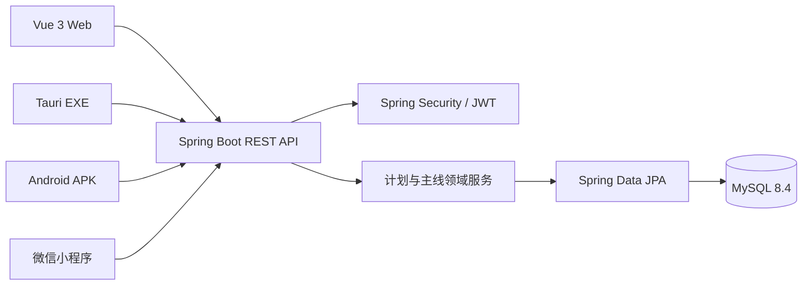

# 架构说明

## 1. 总体结构

当前采用模块化单体，而不是一开始拆微服务。原因是计划、任务、计时和统计存在紧密事务边界；单体更容易保证一致性、测试和部署，也更适合个人项目的运维成本。模块边界稳定后，再按真实压力拆分通知、文件或统计服务。

## 2. 数据一致性

- 所有业务实体使用 UUID 字符串作为公开 ID，避免暴露数据库自增规模。
- 可编辑实体使用 JPA `@Version`。客户端提交自己读取到的版本，版本过期时后端返回 `409 Conflict`。
- 计时暂停与时间流水写入同一事务。
- 用户所有权在 Repository 查询条件中验证，避免只依靠前端隐藏数据。
- 表结构全部由 Flyway 管理，禁止生产环境使用 `ddl-auto=update`。

## 3. 认证

- Access Token：JWT HS256，默认 15 分钟，仅保存在 Web 客户端内存中。
- Refresh Token：随机不可预测字符串，数据库只存 SHA-256 摘要，通过 `HttpOnly + SameSite=Strict` Cookie 传输，可撤销并轮换。
- 密码：BCrypt cost 12。
- Web 刷新页面时使用同站点 Cookie 静默换取新的 Access Token；Refresh Token 不暴露给 JavaScript。
- 公开注册默认关闭；登录失败执行账号与来源地址双维度限流，单账号最多 5 个活跃刷新会话。

## 4. 离线与多端

浏览器客户端已实现服务器权威数据、乐观锁和 IndexedDB 操作队列：

1. 支持离线的普通业务写入 IndexedDB；认证令牌不进入队列。
2. 每条操作携带基础版本和随机幂等键，服务端按用户保存 24 小时响应。
3. 相同键、相同请求可安全重放；相同键但请求指纹不同会返回 `409 Conflict`。
4. 恢复联网后在同步中心按顺序提交；乐观锁冲突停靠等待人工处理，不自动覆盖服务器。
5. 计时、完成、延期和重复任务生成必须在线执行，以服务器时间与事务为准。

当前冲突处理采用“服务器版本优先 + 本地操作停靠”，而不是伪装成字段级自动合并。字段级三方合并需要保存共同基础快照，可在桌面端 SQLite 同步协议阶段继续演进。

## 5. 云端演进

- Nginx/SLB：HTTPS 与反向代理。
- Spring Boot：先单实例，后续无状态横向扩容。
- MySQL：每日备份、时间点恢复和独立数据盘。
- Redis：刷新令牌黑名单、限流、热点统计缓存。
- 对象存储 OSS：用户附件与导出文件。
- 可观测性：Actuator、Prometheus、Grafana、结构化日志和异常告警。
